# AtmoGraph – Week 1 System Architecture

## Overview

AtmoGraph is a full-stack supply chain graph analysis platform. Week 1 establishes the complete graph foundation: data import, graph database, REST API, and interactive visualisation.

## Architecture Diagram

```mermaid
graph TD
    subgraph Data["📂 Data Sources"]
        KG["supplychainKG_clean.csv<br/>16,640 rows"]
        AN["nodes_anon.csv + edges_anon.csv<br/>7,245 nodes · 43,926 edges"]
        PD["Port-disruption-database.xlsx<br/>23 disruption events"]
    end

    subgraph Import["🐍 Python Import Scripts"]
        IS["import_supply_chain.py"]
        IA["import_anonnet.py"]
        IP["import_port_disruptions.py"]
    end

    subgraph Neo4j["🗃️ Neo4j Graph Database"]
        CO["Company nodes<br/>~6,222"]
        CN["Country nodes<br/>~96"]
        IN["Industry nodes<br/>~24"]
        PT["Port nodes<br/>~25"]
        DE["DisruptionEvent nodes<br/>~23"]
        AN2["AnonNode nodes<br/>7,245"]
    end

    subgraph API["⚡ FastAPI Backend"]
        H["/api/health"]
        S["/api/graph/statistics"]
        G["/api/graph"]
        N["/api/graph/node/{id}"]
        NC["/api/graph/node/{id}/connections"]
        SR["/api/graph/search"]
    end

    subgraph Frontend["⚛️ React + Vite Frontend"]
        NB["Navbar (search + status)"]
        SB["Sidebar (filters + legend)"]
        SC["StatisticsCards (6 KPIs)"]
        GV["GraphVisualization (React Flow + dagre)"]
        ND["NodeDetails (1-hop panel)"]
    end

    Data --> Import --> Neo4j --> API --> Frontend
```



## Component Breakdown

### Backend (`backend/`)

| File | Responsibility |
|---|---|
| `app/config.py` | Loads `.env` via pydantic-settings |
| `app/database/neo4j_connection.py` | Driver singleton, `query()` helper |
| `app/database/schema.py` | Node/relationship label constants |
| `app/models/schemas.py` | Pydantic response models |
| `app/services/graph_service.py` | All Cypher query logic |
| `app/routes/graph_routes.py` | FastAPI route handlers |
| `app/main.py` | App factory, CORS, lifespan |

### Import Scripts (`backend/scripts/`)

| Script | Dataset | Creates |
|---|---|---|
| `test_neo4j.py` | — | Connectivity test |
| `import_supply_chain.py` | `supplychainKG_clean.csv` | Company + Country + Industry nodes + 3 rel types |
| `import_anonnet.py` | `nodes_anon.csv` + `edges_anon.csv` | AnonNode + CONNECTS_TO |
| `import_port_disruptions.py` | `Port-disruption-database.xlsx` | Port + DisruptionEvent + PORT_IN + AFFECTED_BY |
| `verify_graph.py` | — | Post-import count checks |

### Frontend (`frontend/src/`)

| Component | Role |
|---|---|
| `services/api.js` | Axios client, all API calls |
| `components/Navbar.jsx` | Logo, Cmd+K search, Neo4j status pill |
| `components/Sidebar.jsx` | Node type filter + relationship legend |
| `components/StatisticsCards.jsx` | 6 KPI cards with live counts |
| `components/GraphVisualization.jsx` | React Flow canvas + dagre layout + custom nodes |
| `components/NodeDetails.jsx` | 1-hop neighbourhood panel |
| `pages/Dashboard.jsx` | Root page, state management |

## Data Flow

```
User opens browser
  → Dashboard mounts
  → fetchHealth()          → GET /api/health        → Neo4j ping
  → fetchStatistics()      → GET /api/statistics    → label/rel counts
  → fetchGraph(limit=150)  → GET /api/graph         → top-N companies by degree
                           → Neo4j Cypher MATCH
                           → returns nodes + relationships JSON
  → GraphVisualization renders
  → dagre layout computed client-side
  → React Flow renders interactive canvas

User clicks a node
  → NodeDetails panel slides in
  → fetchNodeConnections(id) → GET /api/graph/node/{id}/connections
  → 1-hop neighbourhood rendered in panel

User searches "Steel"
  → handleSearch("Steel")  → GET /api/graph/search?q=Steel
  → result pills rendered above graph
  → user clicks pill → NodeDetails opens
```

## Graph Size Strategy

The full KG has **6,222 companies** and **16,640 edges**. Rendering all at once would crash the browser. The strategy:

1. **Default view**: Top 150 companies by `SUPPLIES_TO` out-degree (most connected first)
2. **Filter view**: Any node label (Country, Industry, etc.) up to 150 nodes
3. **Detail view**: Click any node → see its full 1-hop neighbourhood (up to 60 edges)
4. **Search**: Find any node by name, country, or industry → open its detail panel

All 50,000+ nodes remain queryable in Neo4j; only the displayed subgraph is transferred to the browser.
